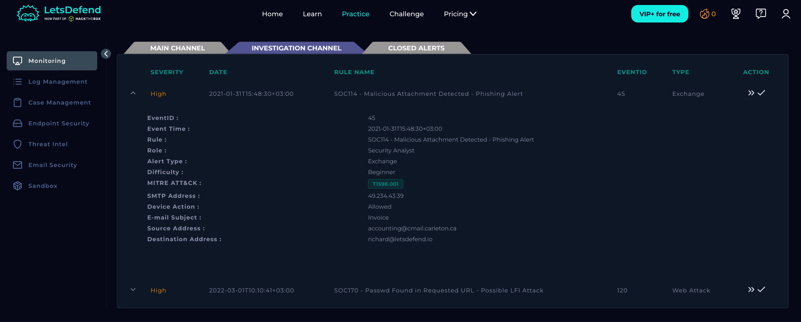
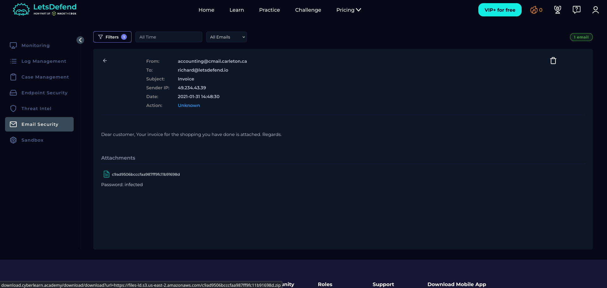
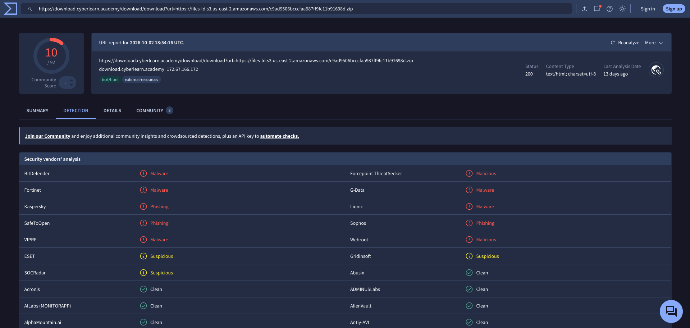
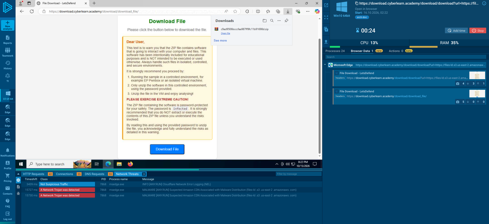
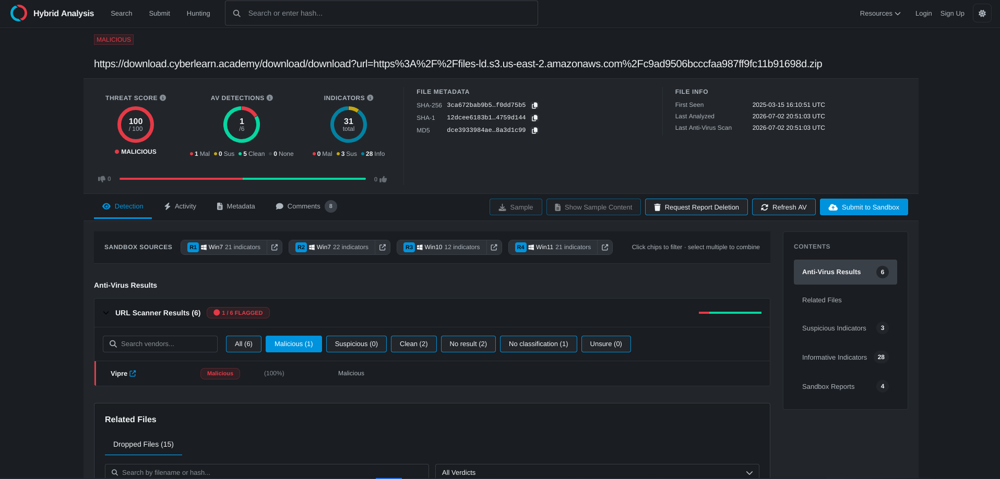
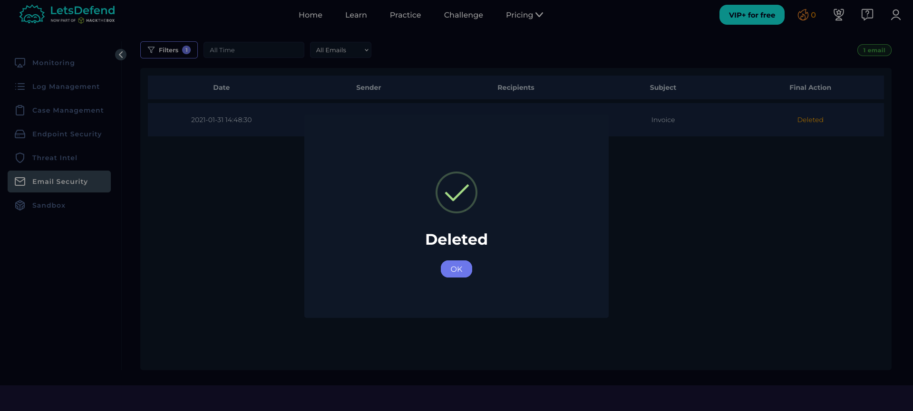
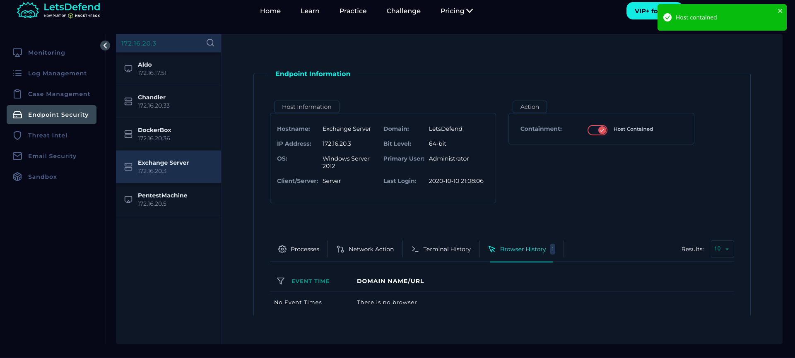

# SOC114 – Malicious Attachment Detected: Phishing Alert

## Alert Information

| Field | Details |
|---|---|
| Alert ID | SOC114 |
| Severity | High |
| Type | Exchange |
| Difficulty | Beginner |
| Playbook | Phishing Playbook – Security Analyst |
| MITRE ATT&CK | T1598.001 |
| Verdict | True Positive |

## 1. Alert Details

The alert was triggered by a suspicious email with the subject **"Invoice"**, sent from `accounting@cmail.carleton.ca` to `richard@letsdefend.io`.

| Field | Details |
|---|---|
| SMTP Server IP | `49.234.43.39` |
| Sender | `accounting@cmail.carleton.ca` |
| Recipient | `richard@letsdefend.io` |
| Subject | Invoice |
| Device Action | Allowed |
| Email Status | Delivered |
| User Interaction | Malicious file/URL opened |

## 2. Email Analysis

The email contained a suspicious URL pointing to a ZIP archive hosted through `download.cyberlearn.academy`.

**URL:**

`https://download.cyberlearn.academy/download/download?url=https://files-ld.s3.us-east-2.amazonaws.com/c9ad9506bcccfaa987ff9fc11b91698d.zip`

The email was delivered to the recipient, and the investigation confirmed that the malicious file or URL was opened.

## 3. VirusTotal Analysis

The suspicious attachment or URL was analyzed using VirusTotal as part of the investigation to assess its reputation and identify potential malicious indicators.

## 4. ANY.RUN Analysis

The suspicious file was analyzed in ANY.RUN to examine its behavior in a sandbox environment and identify potential malicious activity.

## 5. Hybrid Analysis

Hybrid Analysis was used as an additional source of malware-analysis evidence to support the investigation and assess the suspicious file.

## 6. Remediation

The following remediation actions were recorded:

- **Email removal:** The malicious email was deleted to reduce the risk of further interaction.
- **Endpoint containment:** The affected endpoint was isolated to help prevent further malicious activity.
- **Impact assessment:** No confirmed command-and-control (C2) communication or additional impact was identified during the investigation.

## Conclusion

The investigation confirmed that the malicious email was delivered and that the recipient opened the malicious file or URL. The affected endpoint was contained, and the email was deleted as remediation.

No confirmed C2 communication or additional impact was identified in the available investigation results.

**Final Verdict:** True Positive – Malicious Attachment / URL.

**Response Status:** Email deleted; affected endpoint contained.

---

*Platform: LetsDefend | Role: Security Analyst | Purpose: Educational lab writeup*
