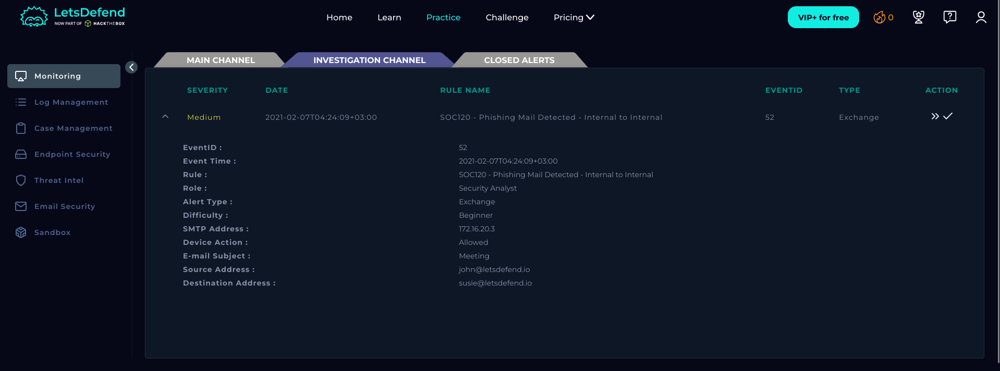
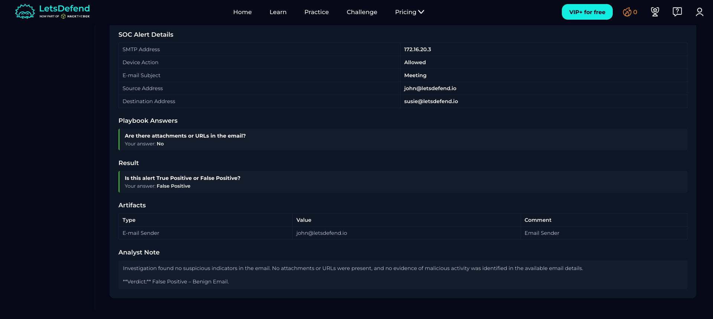

# SOC120 – Phishing Mail Detected: Internal to Internal

## Alert Information

| Field | Details |
|---|---|
| Alert ID | SOC120 |
| Severity | Medium |
| Type | Exchange |
| Difficulty | Beginner |
| Playbook | Phishing Playbook – Security Analyst |
| Verdict | False Positive |

## 1. Alert Details

The alert was triggered by an internal email sent from `john@letsdefend.io` to `susie@letsdefend.io` with the subject **"Meeting"**.

| Field | Details |
|---|---|
| SMTP Server IP | `172.16.20.3` |
| Sender | `john@letsdefend.io` |
| Recipient | `susie@letsdefend.io` |
| Subject | Meeting |
| Device Action | Allowed |

## 2. Investigation

The email was reviewed as part of the phishing investigation. No attachments or URLs were found in the message, and no suspicious indicators were identified in the available email details.

## Conclusion

The investigation found no evidence indicating that the email was malicious. As the message contained no attachments or URLs and no suspicious indicators were identified, the alert was classified as a **False Positive**.

**Final Verdict:** False Positive – Benign Email.

---

*Platform: LetsDefend | Role: Security Analyst | Purpose: Educational lab writeup*
