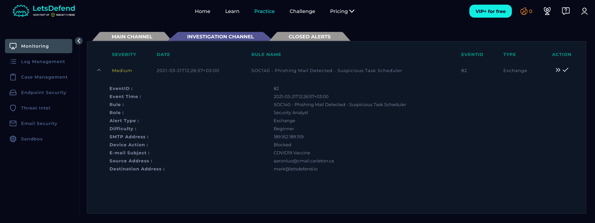
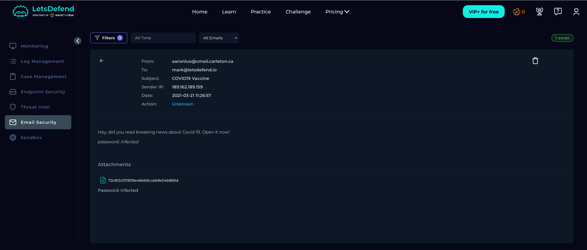
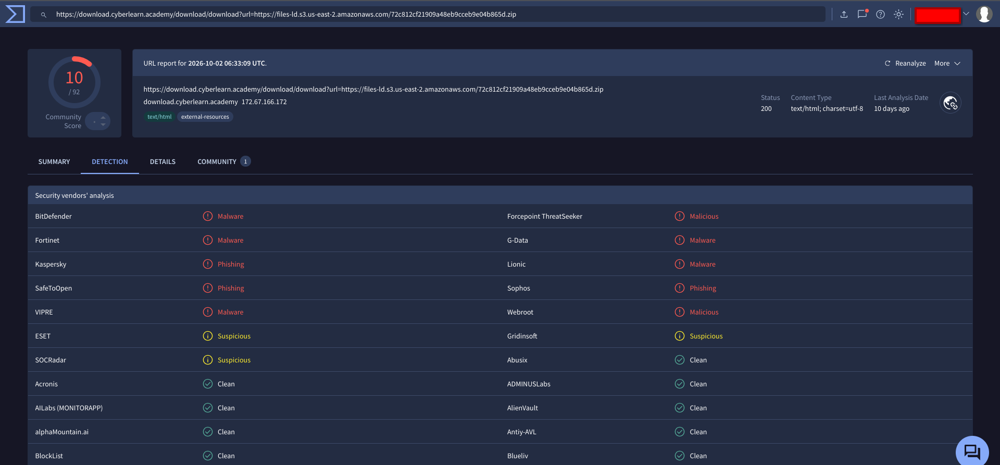
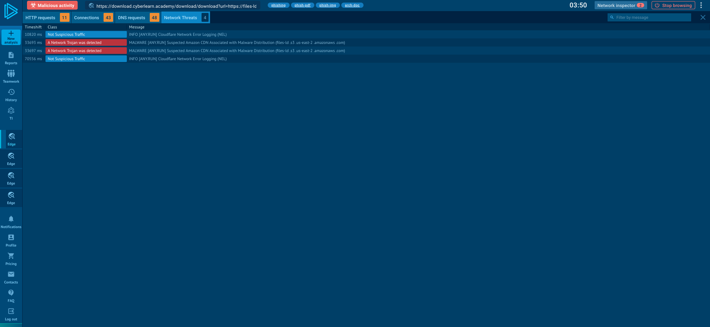
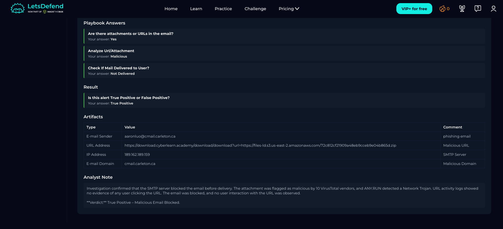

# SOC140 – Phishing Mail Detected: Suspicious Task Scheduler

## Alert Information

| Field | Details |
|---|---|
| Alert ID | SOC140 |
| Severity | Medium |
| Type | Exchange |
| Difficulty | Beginner |
| Playbook | Phishing Playbook – Security Analyst |
| Verdict | True Positive |

## 1. Alert Details

The alert was triggered by a suspicious email with the subject **"COVID19 Vaccine"**. The email was blocked by the SMTP server before delivery to the recipient.

| Field | Details |
|---|---|
| Sender | `aaronluo@cmail.carleton.ca` |
| Recipient | `mark@letsdefend.io` |
| SMTP Server IP | `189.162.189.159` |
| Device Action | Blocked |
| Delivery Status | Not Delivered |

## 2. Email Analysis

The email contained a suspicious URL pointing to a ZIP archive hosted through `download.cyberlearn.academy`. The URL and associated attachment were investigated as part of the phishing analysis.

**URL:**

`https://download.cyberlearn.academy/download/download?url=https://files-ld.s3.us-east-2.amazonaws.com/72c812cf21909a48eb9cceb9e04b865d.zip`

## 3. VirusTotal Analysis

The attachment was scanned using VirusTotal. **10 security vendors flagged the file as malicious**, supporting the assessment that the attachment was unsafe.

## 4. ANY.RUN Analysis

The attachment was analyzed in ANY.RUN, where a **Network Trojan** was detected. This finding provided additional evidence supporting the malicious classification.

## 5. Incident Investigation

The investigation confirmed the following:

- The SMTP server blocked the email before it reached the recipient.
- The attachment was flagged as malicious by VirusTotal and identified as a Network Trojan by ANY.RUN.
- URL activity logs showed no evidence of any user clicking the URL.
- The email was not delivered, preventing the recipient from interacting with it through the email.

## Conclusion

The email was identified as a phishing attempt containing a malicious attachment. The SMTP server blocked the message before delivery, and no evidence of user interaction with the URL was found.

**Final Verdict:** True Positive – Malicious Email Blocked.

**Response Status:** Blocked before delivery; no URL clicks observed.

---

*Platform: LetsDefend | Role: Security Analyst | Purpose: Educational lab writeup*
