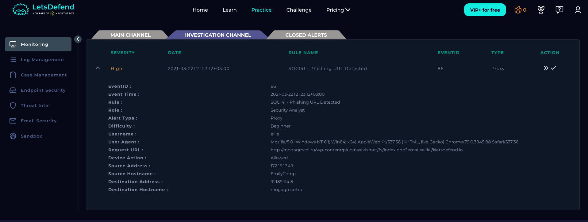
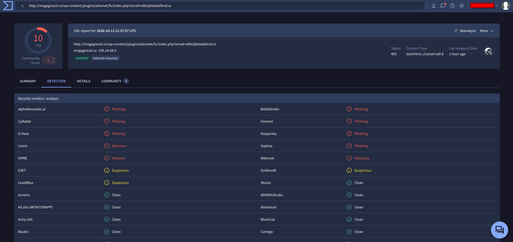
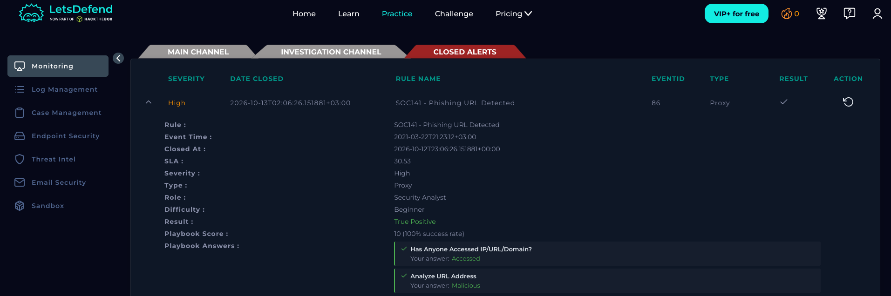

# SOC141 – Phishing URL Detected

## Alert Information

| Field | Details |
|---|---|
| Alert ID | SOC141 |
| Event ID | 86 |
| Severity | High |
| Category | Phishing |
| Event Time | 2021-03-22 21:23:12 (+03:00) |
| Source Host | EmilyComp |
| Source IP | `172.16.17.49` |
| Destination Domain | `mogagrocol.ru` |
| Destination IP | `91.189.114.8` |
| Device Action | Allowed |
| Verdict | True Positive |

## 1. Alert Details

The alert was triggered after a user accessed a suspicious URL hosted on `mogagrocol.ru`. The proxy logs showed that the request was allowed, indicating that the security controls did not block the request at the time of access.

## 2. Phishing URL Analysis

**Requested URL:**

`http://mogagrocol.ru/wp-content/plugins/akismet/fv/index.php?email=ellie@letsdefend.io`

The URL was analyzed using VirusTotal, where **10 out of 90 security vendors** flagged it as malicious or phishing-related. This supported the classification of the URL as malicious.

## 3. Incident Investigation and Response

The investigation confirmed that the user accessed the URL on `2021-03-22 20:23:54 (+03:00)`.

The following response actions were recorded:

- **Endpoint containment:** The affected endpoint (`172.16.17.49`) was isolated to reduce the risk of further malicious activity.
- **Blocking measures:** The URL and associated IP address were added to the proxy and firewall blocklists.
- **Escalation:** The incident was escalated to Level 2 / Incident Response for further forensic investigation.

## 4. Conclusion

The investigation confirmed that a user accessed a malicious phishing URL that bypassed existing filtering controls. The endpoint was isolated, blocking measures were applied, and the incident was escalated for further investigation.

The alert was classified as a **True Positive**. However, the available evidence does not independently confirm malware execution, credential theft, or successful endpoint compromise.

**Final Verdict:** True Positive – Malicious URL Accessed.

**Response Status:** Endpoint contained, URL/IP blocked, and incident escalated to L2/IR.

---

*Environment: LetsDefend | Role: Security Analyst | Purpose: Educational lab writeup*
